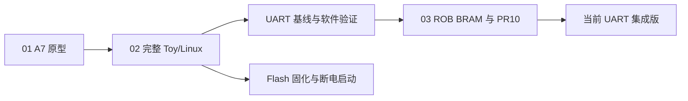

# FPGA 适配阶段与历史版本

阶段按硬件/系统方案划分；验证批次和接口修复归入对应阶段，不另算一个阶段。
当前开发与使用入口是 [Toy/Linux 平台](../platforms/arty-a7-toy/README.md)。

| 阶段 | 方案与演进 | 内部分类 | 状态 |
|---|---|---|---|
| [01 最早 A7 原型](01-arty-a7-prototype/README.md) | 简化 CPU、BRAM、SMatMul 8×16 | `project/` 旧工程与验证 | 无 Linux/VM/FPU，已被替代 |
| [02 完整 Toy/Linux](02-toy-linux/README.md) | CPU、Sv39、FPU、Gemmini 8×8、DDR | `uart/` 基线与软件验证；`flash/` 固化和冷启动 | UART 被优化版替代；旧 Flash 可作恢复方案 |
| [03 ROB/PR10](03-rob-pr10/README.md) | 保留系统功能，优化存储与修正接口 | `uart/` 中间候选；`fixes/` 评估与自检 | 当前代码在平台目录，中间记录归档于此 |

## 当前使用什么

- 新版 UART：[run_hardware.ps1](../platforms/arty-a7-toy/run_hardware.ps1)，固定发布 `arty-a7-rob-pr10-2026-10-13`，属于阶段 03。
- 旧版 Flash：平台中的 `boot/`、构建/烧写/观察入口仍保留，使用阶段 02 Flash 对应产物；见 [Flash 指南](../platforms/arty-a7-toy/FLASH_BOOT.md)。
- K7 是另一板卡路线，保留在 [platforms/xc7k160t](../platforms/xc7k160t/README.md)。

## 如何看历史

先读阶段 README，再选 UART/Flash 或验证子目录。每个阶段说明方案、变化、验证范围和后续关系。
原报告、日志、源码/文档快照与 JSON 保留原字节；旧路径、状态及相对链接属于当时布局，
以阶段 README 为当前导航。重建旧工程应检出对应提交或取对应 Release，避免混入当前构建。
[INDEX.json](INDEX.json)记录分类/迁移路径，[MOVED_FILES.json](MOVED_FILES.json)记录原文件摘要。
通过结论只适用于对应位流、软件与测试范围，UART/Flash 不能交叉引用 PPA 基线。
